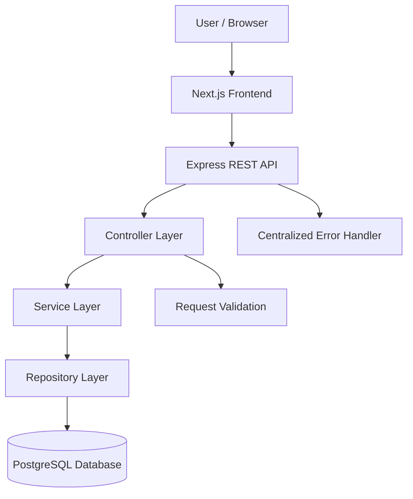
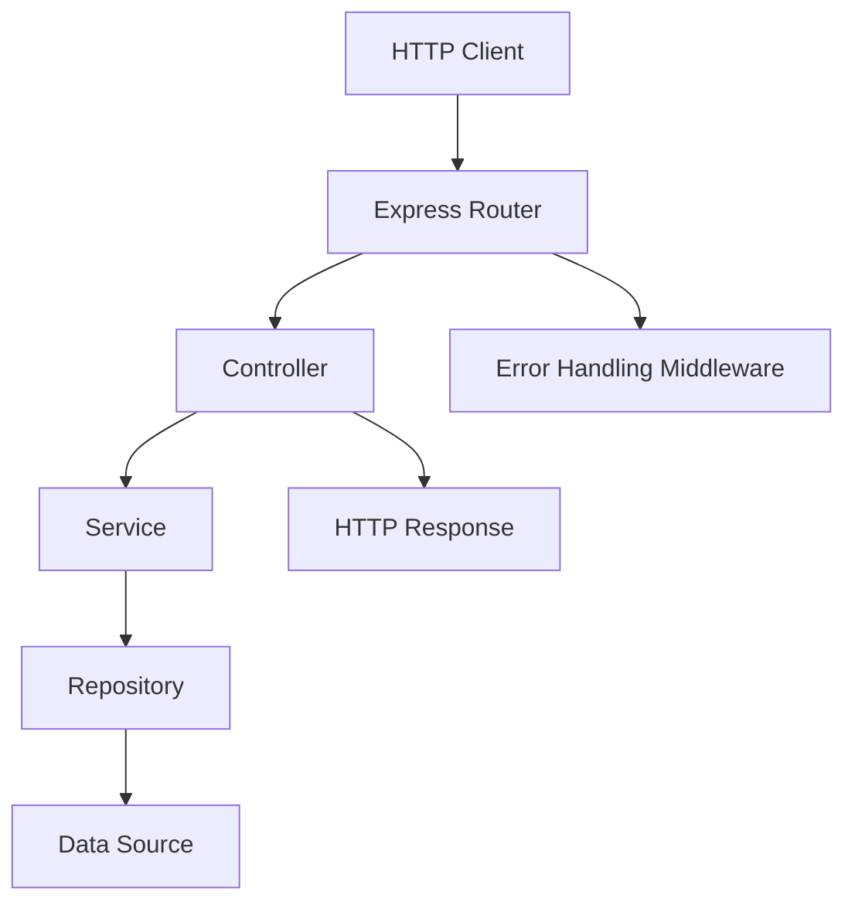

# VisionRoot Software Engineering Training: Service Request Management System

[](https://github.com/GimhaniDilmika/VisionRoot-Software-Engineer-Training)
[](https://github.com/GimhaniDilmika/VisionRoot-Software-Engineer-Training)
[](https://github.com/GimhaniDilmika/VisionRoot-Software-Engineer-Training)
[](https://github.com/GimhaniDilmika/VisionRoot-Software-Engineer-Training)
[](https://nodejs.org)
[](https://www.typescriptlang.org)

Welcome to the **VisionRoot Trainee Software Engineer** 10-day training repository.

This project follows a structured, learn-by-building pathway focused on practical web application development, software architecture, clean code, API engineering, database design, automated testing, security, and technical documentation.

**Current Training Progress: Day 05 Completed — Backend API & Service Layer**

---

## 🎯 Engineering Principle

> **"Do not only make the feature work. Make it understandable, testable, secure, maintainable and documented."**

---

## 📋 Project Overview & Repository Information

The **Service Request Management System** is an internal full-stack web application designed for organizational staff to submit, track, and manage IT and Facilities service requests.

The system is designed around clearly separated frontend, API, business logic, and persistence responsibilities.

### Project Information

| Property | Description |
|---|---|
| Project | Service Request Management System |
| Organization | VisionRoot (Pvt) Ltd |
| Role | Trainee Software Engineer |
| Training Duration | 2 Weeks / 10 Working Days |
| Repository | [GitHub Repository](https://github.com/GimhaniDilmika/VisionRoot-Software-Engineer-Training) |
| Default Branch | `main` |
| Architecture | Modular Monolith |
| Frontend | Next.js, React, TypeScript |
| Backend | Node.js, Express.js, TypeScript |
| Database | PostgreSQL |
| Current Progress | Day 05 Completed |
| Next Task | Day 06 — Database and Persistence |

### Core Application Features

- Create service requests with descriptions, categories, and priorities.
- View service requests through a structured list.
- Access detailed information about individual requests.
- Support request status tracking and future workflow transitions.
- Validate user input and return consistent API responses.
- Organize backend responsibilities into controllers, services, and repositories.
- Provide health-check endpoints and centralized error handling.
- Introduce PostgreSQL persistence during Day 06.

---

## 💻 Prerequisites & Environment Requirements

Before running the application, install the following development tools.

| Prerequisite | Minimum Version | Previously Verified Local Version | Purpose |
|---|---|---|---|
| Node.js | >= 20.0.0 | v20.20.2 | JavaScript runtime |
| npm | >= 10.0.0 | 10.8.2 | Package management |
| Git | >= 2.40.0 | 2.49.0.windows.1 | Version control |
| PostgreSQL | >= 15.0 | 18.6 | Database persistence |

---

## 🏗️ System Architecture

The application follows a **Modular Monolith Architecture**, separating frontend presentation, backend API handling, business logic, and database operations.

### Architecture Diagram



### Layer Responsibilities

| Layer | Responsibility |
|---|---|
| Frontend | User interfaces, forms, navigation, and feedback |
| Routes | Map HTTP endpoints to controllers |
| Controllers | Process requests and prepare HTTP responses |
| Validation | Validate incoming request data |
| Services | Execute application business rules |
| Repositories | Manage data access operations |
| Database | Persist service request records |
| Middleware | Handle errors and cross-cutting concerns |

**Architectural Principle:** Business logic belongs in the service layer, while persistence logic belongs in the repository layer.

---

## 📁 Repository Directory Structure

The repository uses a modular monorepo structure with separate frontend, backend, documentation, and evidence directories.

```text
VisionRoot-Training/
│
├── README.md
├── package.json
├── package-lock.json
├── .gitignore
├── .env.example
│
├── .github/
│   └── pull_request_template.md
│
├── docs/
│   ├── requirements.md
│   ├── architecture.md
│   ├── data-model.md
│   ├── api-contract.md
│   ├── deployment.md
│   └── decisions/
│       └── ADR-001-architecture.md
│
├── backend/
│   ├── package.json
│   ├── tsconfig.json
│   ├── .env.example
│   └── src/
│       ├── app.ts
│       ├── server.ts
│       ├── middleware/
│       │   ├── error-handler.ts
│       │   ├── not-found.ts
│       │   └── request-logger.ts
│       └── modules/
│           └── requests/
│               ├── controller.ts
│               ├── repository.ts
│               ├── routes.ts
│               ├── service.ts
│               └── types.ts
│
├── frontend/
│   ├── package.json
│   ├── tsconfig.json
│   ├── next.config.js
│   ├── .env.example
│   └── src/
│       └── app/
│           ├── layout.tsx
│           ├── page.tsx
│           └── requests/
│               ├── page.tsx
│               ├── new/
│               │   └── page.tsx
│               └── [id]/
│                   └── page.tsx
│
└── evidence/
    ├── Day-01/
    ├── Day-02/
    ├── Day-03/
    ├── Day-04/
    └── Day-05/
```

---

## 🚀 Quick-Start Setup Guide (Windows PowerShell)

### Step 1: Clone the Repository

```powershell
git clone https://github.com/GimhaniDilmika/VisionRoot-Software-Engineer-Training.git

cd VisionRoot-Software-Engineer-Training
```

### Step 2: Install Dependencies

Install all project dependencies from the repository root.

```powershell
npm install
```

### Step 3: Configure Environment Variables

Create local environment files from the example templates.

```powershell
Copy-Item backend\.env.example backend\.env

Copy-Item frontend\.env.example frontend\.env.local
```

> **Security:** Never commit `.env`, `.env.local`, API keys, database passwords, access tokens, or private credentials to GitHub.

### Step 4: Start the Backend

```powershell
npm run dev:backend
```

Expected backend address:

```text
http://localhost:5000
```

### Step 5: Start the Frontend

Open a second terminal.

```powershell
npm run dev:frontend
```

Expected frontend address:

```text
http://localhost:3000
```

---

## 🛠️ Development, Build & Verification Commands

| Command | Purpose |
|---|---|
| `npm install` | Install project dependencies |
| `npm run dev:backend` | Start Express backend |
| `npm run dev:frontend` | Start Next.js frontend |
| `npm run build` | Build frontend and backend |
| `npm run type-check` | Check TypeScript types |
| `npm run lint` | Check code quality |

### Verify Backend Health

```powershell
Invoke-RestMethod -Uri "http://localhost:5000/api/health"
```

### Verify Frontend

Open:

```text
http://localhost:3000
```

---

## 🔗 Application Routes

| Route | Description |
|---|---|
| `/` | Application landing page |
| `/requests` | Service request list |
| `/requests/new` | Create new service request |
| `/requests/[id]` | Service request details |

The Day 04 frontend uses a mock service for UI development. Database persistence is a separate Day 06 activity.

---

## 🌿 Git Branch & Pull Request Workflow

All development follows a feature-branch workflow.

### Step 1: Update Main Branch

```powershell
git checkout main
git pull origin main
```

### Step 2: Create Feature Branch

```powershell
git checkout -b feature/day-05-backend-api
```

### Step 3: Stage Changes

```powershell
git add .
```

### Step 4: Commit Changes

```powershell
git commit -m "feat: implement Day 05 backend API and service layer"
```

### Step 5: Push Branch

```powershell
git push -u origin feature/day-05-backend-api
```

### Step 6: Create Pull Request

Open GitHub and create a Pull Request targeting `main`.

Include:

- Implemented features.
- API request and response evidence.
- Validation and error handling evidence.
- Test results.
- Known issues and limitations.

---

# 🗓️ 10-Day Training Roadmap & Progress Tracker

| Day | Training Topic | Status | Deliverables |
|---|---|---|---|
| Day 01 | Requirements and SDLC | ✅ Completed | [docs/requirements.md](docs/requirements.md), [evidence/Day-01/daily-log.md](evidence/Day-01/daily-log.md) |
| Day 02 | Architecture and System Design | ✅ Completed | [docs/architecture.md](docs/architecture.md), [docs/data-model.md](docs/data-model.md), [docs/api-contract.md](docs/api-contract.md), [ADR-001](docs/decisions/ADR-001-architecture.md) |
| Day 03 | GitHub Workflow & Environment Setup | ✅ Completed | [package.json](package.json), [backend/](backend/), [frontend/](frontend/), [evidence/Day-03/daily-log.md](evidence/Day-03/daily-log.md) |
| Day 04 | Frontend Architecture & UI | ✅ Completed | [evidence/Day-04/daily-log.md](evidence/Day-04/daily-log.md), [evidence/Day-04/PR_DESCRIPTION.md](evidence/Day-04/PR_DESCRIPTION.md) |
| Day 05 | Backend API & Service Layer | ✅ Completed | [evidence/Day-05/daily-log.md](evidence/Day-05/daily-log.md), [evidence/Day-05/api-test-results.md](evidence/Day-05/api-test-results.md), [evidence/Day-05/PR_DESCRIPTION.md](evidence/Day-05/PR_DESCRIPTION.md) |
| Day 06 | Database & Persistence | ⏳ Planned | PostgreSQL schema, migrations, repository integration |
| Day 07 | Full-Stack Integration | ⏳ Planned | Frontend/API integration, business workflows |
| Day 08 | Automated Testing & Quality | ⏳ Planned | Unit tests, integration tests, debugging |
| Day 09 | Security, Deployment & Operations | ⏳ Planned | Security review, deployment documentation |
| Day 10 | Final Review, Demo & Handover | ⏳ Planned | Demo, review, final documentation |

---

# 📚 Daily Training Summaries

## ✅ Day 01 — Requirements and SDLC

**Objective:** Understand the problem and define successful completion criteria.

### Work Completed

- Identified the problem of manual service request tracking.
- Defined primary user personas:
  - Requester
  - Support Agent
  - System Administrator
- Created seven user stories with acceptance criteria.
- Defined functional and non-functional requirements.
- Prioritized the product backlog using the MoSCoW method.
- Created a Definition of Done.
- Prepared requirement documentation.

### Deliverables

- `docs/requirements.md`
- `evidence/Day-01/daily-log.md`

### Learning Outcome

Understood the Software Development Life Cycle, requirements analysis, user stories, acceptance criteria, and backlog management.

---

## ✅ Day 02 — Architecture and System Design

**Objective:** Design the application before implementing features across multiple layers.

### Work Completed

- Selected Modular Monolith Architecture.
- Designed system context and container diagrams.
- Identified frontend, backend, service, and persistence responsibilities.
- Prepared the relational data model.
- Designed the REST API contract.
- Documented an Architecture Decision Record.
- Defined validation boundaries and error response conventions.

### Deliverables

- `docs/architecture.md`
- `docs/data-model.md`
- `docs/api-contract.md`
- `docs/decisions/ADR-001-architecture.md`
- `evidence/Day-02/daily-log.md`

### Learning Outcome

Understood layered architecture, separation of concerns, database modeling, API design, and architecture decision documentation.

---

## ✅ Day 03 — GitHub Workflow and Environment Setup

**Objective:** Make the project reproducible and establish a professional development workflow.

### Work Completed

- Created an npm workspace monorepo.
- Configured the Express.js and TypeScript backend.
- Configured the Next.js and React frontend.
- Added environment configuration templates.
- Configured `.gitignore` for secret protection.
- Implemented initial backend root and health endpoints.
- Verified frontend and backend compilation.
- Documented local setup and Git workflow.

### Deliverables

- Root `package.json`
- `backend/`
- `frontend/`
- `.env.example`
- `README.md`
- `evidence/Day-03/daily-log.md`

### Learning Outcome

Gained practical knowledge of Git branching, commits, pull requests, project configuration, environment variables, and development workflows.

---

## ✅ Day 04 — Frontend Architecture and UI

**Objective:** Create a usable frontend with clear component boundaries and UI states.

### Work Completed

- Organized frontend components by features.
- Created the application landing page.
- Implemented the service request list page.
- Implemented the create-request form.
- Implemented the request details page.
- Added form validation.
- Handled loading, error, empty, and success states.
- Added mock request data.
- Developed reusable UI components.
- Improved keyboard accessibility.
- Verified frontend TypeScript compilation and production build.

### Frontend Routes

| Route | Purpose |
|---|---|
| `/` | Home page |
| `/requests` | Request list |
| `/requests/new` | Create request |
| `/requests/[id]` | Request details |

### Deliverables

- Frontend application pages
- Reusable components
- Request validation
- Mock data service
- `evidence/Day-04/daily-log.md`
- `evidence/Day-04/PR_DESCRIPTION.md`

### Learning Outcome

Understood React components, Next.js routing, frontend architecture, form validation, UI state management, and API client separation.

---

# ✅ Day 05 — Backend API and Service Layer

**Status: Completed**

**Objective:** Implement backend endpoints with clear responsibilities and predictable API responses.

Day 05 focuses on developing the backend API for the Service Request Management System while maintaining separation between HTTP handling, business logic, and data access.

## 1. Backend API Architecture

The backend uses a layered design.



### Responsibilities

**Route Layer**
- Defines API paths.
- Associates HTTP methods with controllers.
- Applies relevant middleware.

**Controller Layer**
- Receives requests.
- Processes request parameters and validated input.
- Invokes application services.
- Returns appropriate HTTP responses.

**Service Layer**
- Implements business rules.
- Coordinates request creation and retrieval.
- Keeps business logic separate from HTTP handling.

**Repository Layer**
- Encapsulates data access operations.
- Provides an interface between services and data storage.
- Supports future PostgreSQL integration.

**Middleware Layer**
- Handles centralized application errors.
- Produces consistent error responses.

---

## 2. REST API Endpoints

The Day 05 API scope includes Create, List, Get-by-ID, Status Update, and Health operations.

| HTTP Method | Endpoint | Purpose | Expected Success Status |
|---|---|---|---|
| POST | `/api/requests` | Create a service request | 201 Created |
| GET | `/api/requests` | Retrieve service requests | 200 OK |
| GET | `/api/requests/:id` | Retrieve a request by ID | 200 OK |
| PATCH | `/api/requests/:id/status` | Update status (state machine transition) | 200 OK |
| GET | `/api/health` | Check backend health | 200 OK |

The endpoints follow the previously documented API contract.

### Create Request

**Method:** `POST`

**Endpoint:**

```text
/api/requests
```

Example request body:

```json
{
  "title": "Office printer is not working",
  "description": "The printer is not responding when staff try to print documents.",
  "category": "IT",
  "priority": "MEDIUM"
}
```

**Expected behavior:**

- Validate required fields.
- Reject invalid input.
- Pass validated data to the service layer.
- Create the request through the configured repository.
- Return HTTP 201 with the created record.

### List Requests

**Method:** `GET`

**Endpoint:**

```text
/api/requests
```

**Expected behavior:**

- Retrieve the available requests.
- Return a consistent JSON response.
- Return an empty list when no requests exist.
- Keep response formatting predictable.

### Get Request by ID

**Method:** `GET`

**Endpoint:**

```text
/api/requests/:id
```

**Expected behavior:**

- Validate the supplied request identifier.
- Retrieve the matching service request.
- Return HTTP 200 when found.
- Return HTTP 404 when the requested record does not exist.

### Update Request Status

**Method:** `PATCH`

**Endpoint:**

```text
/api/requests/:id/status
```

Example request body:

```json
{
  "status": "IN_PROGRESS"
}
```

**Expected behavior:**

- Validate UUID format.
- Enforce strict linear state machine transitions (`OPEN` $\rightarrow$ `IN_PROGRESS` $\rightarrow$ `RESOLVED` $\rightarrow$ `CLOSED`).
- Reject illegal jumps (e.g. `IN_PROGRESS` to `CLOSED`) with HTTP 400.
- Reject any modification of terminal `CLOSED` tickets.

### Health Check

**Method:** `GET`

**Endpoint:**

```text
/api/health
```

**Expected behavior:**

- Provide a lightweight health response.
- Confirm that the backend process is responding.
- Avoid exposing sensitive internal information.

---

## 3. Input Validation

Backend validation is essential because frontend validation alone cannot guarantee API safety.

The API contract defines request validation requirements.

| Field | Validation Rule |
|---|---|
| `title` | Required string, 5–100 characters |
| `description` | Required string, 10–1000 characters |
| `category` | Must match an allowed category (`IT`, `Facilities`, `Other`) |
| `priority` | Must match an allowed priority (`LOW`, `MEDIUM`, `HIGH`) |
| `id` | Must be a valid UUID v4 identifier |

### Validation Requirements

- Reject missing required fields.
- Reject invalid field types.
- Reject values outside allowed ranges.
- Reject unsupported enum values.
- Return meaningful validation messages.
- Prevent invalid requests from entering the service layer.

---

## 4. Standard HTTP Responses

| Status Code | Meaning | Usage |
|---|---|---|
| 200 | OK | Successful retrieval or status update |
| 201 | Created | Successful request creation |
| 400 | Bad Request | Invalid request data or illegal state transition |
| 404 | Not Found | Request does not exist |
| 500 | Internal Server Error | Unexpected server failure |

A standardized response format improves consistency between frontend and backend.

### Example Success Response Structure

```json
{
  "success": true,
  "data": {
    "id": "550e8400-e29b-41d4-a716-446655440000",
    "title": "Office printer is not working",
    "category": "IT",
    "priority": "MEDIUM",
    "status": "OPEN"
  }
}
```

### Example Error Response Structure

```json
{
  "success": false,
  "error": {
    "code": "VALIDATION_ERROR",
    "message": "Invalid request data",
    "details": [
      {
        "field": "title",
        "message": "Title must be at least 5 characters long"
      }
    ]
  },
  "timestamp": "2026-11-13T16:00:00.000Z"
}
```

---

## 5. Business Logic and Repository Separation

Day 05 emphasizes maintaining clear boundaries.

### Controller Responsibilities

- Handle HTTP requests.
- Invoke validation and service operations.
- Return HTTP status codes and JSON responses.

### Service Responsibilities

- Coordinate business operations.
- Enforce relevant request business rules.
- Avoid direct HTTP request and response dependencies.

### Repository Responsibilities

- Provide request storage and retrieval operations.
- Isolate the storage implementation.
- Support replacing temporary storage with PostgreSQL in Day 06.

### Benefits

- Improved maintainability.
- Easier unit testing.
- Better separation of concerns.
- Reduced code duplication.
- Simpler database integration.

---

## 6. Centralized Error Handling

Centralized error handling provides consistent responses across the application.

### Error Handling Goals

- Handle invalid inputs consistently.
- Return 404 for missing records.
- Avoid exposing internal stack traces.
- Use predictable error response structures.
- Keep controllers focused on HTTP responsibilities.

---

## 7. API Testing and Verification

Day 05 testing covers the functional behavior of each endpoint and status transition.

### Test Checklist

- [x] POST creates a valid service request (HTTP 201).
- [x] POST rejects invalid input (missing title, short title, invalid category/priority) with HTTP 400.
- [x] GET returns available service requests (5 seed records, sorted newest first).
- [x] GET with `?status=` filter correctly filters records.
- [x] GET by ID retrieves an existing request.
- [x] GET by ID returns 404 for an unknown UUID.
- [x] GET/PATCH rejects invalid UUID format with HTTP 400 `INVALID_IDENTIFIER`.
- [x] PATCH successfully advances status through valid transitions (`OPEN` $\rightarrow$ `IN_PROGRESS` $\rightarrow$ `RESOLVED` $\rightarrow$ `CLOSED`).
- [x] PATCH rejects skipping states (e.g. `IN_PROGRESS` directly to `CLOSED`) with HTTP 400 `INVALID_STATE_TRANSITION`.
- [x] PATCH rejects backward transitions and modifications to terminal `CLOSED` requests.
- [x] Health endpoint returns a successful response (`/api/health`).
- [x] Centralized error handling produces consistent responses without leaking stack traces.
- [x] Backend TypeScript checks pass (`npm run type-check:backend` $\rightarrow$ 0 errors).
- [x] Backend build completes successfully (`npm run build:backend` $\rightarrow$ 0 errors).

### Example PowerShell Commands

**Health Endpoint**

```powershell
Invoke-RestMethod -Uri "http://localhost:5000/api/health"
```

**List Requests**

```powershell
Invoke-RestMethod -Uri "http://localhost:5000/api/requests"
```

**Create Request**

```powershell
$body = @{
    title = "Office printer is not working"
    description = "The office printer is not responding."
    category = "IT"
    priority = "MEDIUM"
} | ConvertTo-Json

Invoke-RestMethod `
    -Uri "http://localhost:5000/api/requests" `
    -Method POST `
    -ContentType "application/json" `
    -Body $body
```

**Get Request by ID**

```powershell
Invoke-RestMethod -Uri "http://localhost:5000/api/requests/550e8400-e29b-41d4-a716-446655440000"
```

**Update Status**

```powershell
$statusBody = @{ status = "IN_PROGRESS" } | ConvertTo-Json

Invoke-RestMethod `
    -Uri "http://localhost:5000/api/requests/550e8400-e29b-41d4-a716-446655440000/status" `
    -Method PATCH `
    -ContentType "application/json" `
    -Body $statusBody
```

**Verify Backend TypeScript**

```powershell
npm run type-check:backend
```

**Verify Backend Build**

```powershell
npm run build:backend
```

**Check Git Changes**

```powershell
git diff --check
```

---

## 8. Day 05 GitHub Evidence

According to the VisionRoot training guide, Day 05 evidence includes:

- Backend source code (`app.ts`, `server.ts`, `middleware/`, `modules/requests/`).
- Updated API contract with actual behavior.
- Full 27-test API request and response verification log.
- Invalid-input and illegal state transition test examples.
- Daily learning log.
- Repository and service responsibility documentation.
- Git commit and pull request evidence.

### Evidence Location

```text
evidence/
└── Day-05/
    ├── daily-log.md
    ├── PR_DESCRIPTION.md
    └── api-test-results.md
```

### Daily Evidence Record

| Item | Description |
|---|---|
| Day | 05 |
| Topic | Backend API and Service Layer |
| Objective | Implement endpoints with clear responsibilities |
| Main Scope | REST endpoints, validation, services, repositories, error handling |
| Documentation | [API Contract](docs/api-contract.md) and [Daily Evidence](evidence/Day-05/daily-log.md) |
| Test Results | [27/27 Passing API Tests](evidence/Day-05/api-test-results.md) |
| PR Description | [Day 05 PR Description](evidence/Day-05/PR_DESCRIPTION.md) |
| Next Step | Database and Persistence |

### End-of-Day Review

**Review Question:**

> Can the API be tested without the frontend, and are errors safe and consistent?

**Answer:** Yes. All endpoints were verified via automated HTTP requests using `curl.exe` and PowerShell without running the frontend. Every failure scenario returns a standardized JSON envelope with typed error codes (`VALIDATION_ERROR`, `INVALID_IDENTIFIER`, `INVALID_STATE_TRANSITION`, `NOT_FOUND`), and internal 500 errors never leak stack traces.

---

## 🔜 Day 06 — Database and Persistence

**Status: Planned**

**Objective:** Persist service request data using a proper relational database setup.

### Planned Activities

1. Review database tables, primary keys, constraints, indexes, and migrations.
2. Create the PostgreSQL request schema.
3. Implement or configure migrations.
4. Connect repository methods to PostgreSQL.
5. Verify records persist after restarting the application.
6. Test a missing or invalid database configuration.
7. Update database setup documentation.
8. Record migration and persistence evidence.

### Expected Deliverables

- PostgreSQL schema and migration files.
- Database configuration documentation.
- Repository integration.
- Persistence test results.
- Updated `docs/data-model.md`.
- `evidence/Day-06/daily-log.md`.

---

## 🔒 Security and Professional Development Standards

The project follows the security and professional standards outlined in the training guide.

- Never commit passwords, API keys, access tokens, or private data.
- Validate incoming request data.
- Use clear error messages without leaking sensitive internals.
- Keep business logic out of controller and repository layers.
- Write maintainable, testable, and understandable code.
- Use meaningful commits and feature branches.
- Document design decisions and limitations.
- Record actual test evidence.
- Keep GitHub documentation updated with development progress.
- Never deploy or access production systems without authorization.

---

## ⚠️ Common Setup Troubleshooting

| Issue | Possible Cause | Suggested Solution |
|---|---|---|
| Backend port already in use | Another process uses port 5000 | Stop the conflicting process |
| Frontend cannot connect to API | Backend is not running | Start `npm run dev:backend` |
| Environment variable missing | Local `.env` not configured | Copy and configure `.env.example` |
| PostgreSQL command not found | PostgreSQL is not in PATH | Add PostgreSQL binaries to PATH |
| API returns 400 | Invalid request data | Review field validation rules |
| API returns 404 | Requested resource does not exist | Verify the request ID and endpoint |
| API returns 500 | Unexpected backend error | Review server logs without exposing secrets |

---

## 📊 Current Training Completion Summary

**Completed:** 5 of 10 training days.

```text
Day 01  ✅ Requirements and SDLC
Day 02  ✅ Architecture and System Design
Day 03  ✅ GitHub Workflow and Environment
Day 04  ✅ Frontend Architecture and UI
Day 05  ✅ Backend API and Service Layer
Day 06  ⏳ Database and Persistence
Day 07  ⏳ Full-Stack Integration
Day 08  ⏳ Automated Testing and Quality
Day 09  ⏳ Security and Deployment
Day 10  ⏳ Final Review and Handover
```

**Overall Progress: 50% of the 10-day training roadmap completed.**

---

## 🏁 Conclusion

The VisionRoot Service Request Management System training project has progressed through its first five development stages:

1. Requirements Analysis
2. Architecture Design
3. Environment and GitHub Setup
4. Frontend Development
5. Backend API and Service Layer

Day 05 establishes the intended backend API and layered responsibilities needed for the next phase.

The next milestone is **Day 06 — Database and Persistence**, where PostgreSQL will be integrated to support persistent service request storage.

The overall development approach prioritizes understandable architecture, code maintainability, testability, and professional engineering documentation.

---

**Developed as part of the VisionRoot Trainee Software Engineer Training Programme.**

**Organization:** VisionRoot (Pvt) Ltd

**Project:** Service Request Management System

**Training Status:** Day 05 Completed
