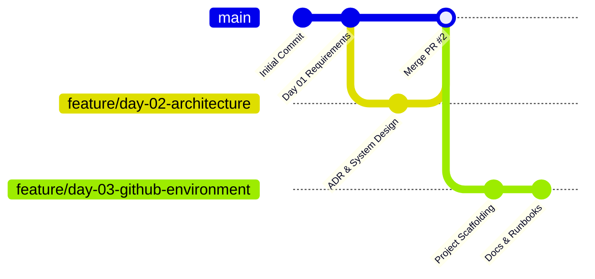

# VisionRoot Software Engineering Training: Service Request Management System

[](https://github.com/GimhaniDilmika/VisionRoot-Software-Engineer-Training)
[](https://github.com/GimhaniDilmika/VisionRoot-Software-Engineer-Training)
[](https://github.com/GimhaniDilmika/VisionRoot-Software-Engineer-Training)
[](https://github.com/GimhaniDilmika/VisionRoot-Software-Engineer-Training)
[](https://nodejs.org)
[](https://www.typescriptlang.org)

Welcome to the **VisionRoot Trainee Software Engineer** 10-day onboarding repository. This project follows a structured, learn-by-building pathway focused on practical web application development, software architecture, clean code, API engineering, database design, automated testing, security, and technical documentation.

---

## 🎯 Engineering Principle

> **"Do not only make the feature work. Make it understandable, testable, secure, maintainable and documented."**

---

## 📋 Project Overview & Repository Information

The **Service Request Management System** is an internal full-stack web application designed for organization staff to submit, track, and manage IT and Facilities service requests. The system enforces domain business rules, validates status transitions, provides robust error handling, and persists records securely in PostgreSQL.

- **Repository URL:** [https://github.com/GimhaniDilmika/VisionRoot-Software-Engineer-Training](https://github.com/GimhaniDilmika/VisionRoot-Software-Engineer-Training)
- **Default Branch:** `main`
- **Architecture Pattern:** Modular Monolith (Next.js Client + Express.js API + PostgreSQL)

---

## 💻 Prerequisites & Environment Requirements

Before running the application, ensure the following software tools are installed on your workstation:

| Prerequisite | Minimum Required Version | Verified Local Version | Purpose |
| :--- | :--- | :--- | :--- |
| **Node.js** | `>= 20.0.0` (LTS) | `v20.20.2` | JavaScript runtime environment for backend and frontend tooling |
| **npm** | `>= 10.0.0` | `10.8.2` | Dependency management with Monorepo Workspaces support |
| **Git** | `>= 2.40.0` | `2.49.0.windows.1` | Distributed version control and contribution workflows |
| **PostgreSQL** | `>= 15.0` | `18.6` (Service: `postgresql-x64-18`) | Relational persistence and schema migrations (Used in Day 06) |

---

## 📁 Repository Directory Structure

The repository is structured as a **modular monorepo** using npm workspaces to keep the Next.js frontend and Express backend unified, reproducible, and decoupled:

```text
VisionRoot-Training/
├── README.md                           # Master project runbook, setup instructions & roadmap
├── package.json                        # Monorepo workspaces orchestration & root scripts
├── package-lock.json                   # Deterministic lockfile across all workspaces
├── .gitignore                          # Strict credential, log, and build exclusions
├── .env.example                        # Consolidated environment variable template
├── .github/
│   └── pull_request_template.md        # Standardized PR submission template
├── docs/                               # Architectural & requirement specifications
│   ├── requirements.md                 # Day 01: Problem statement, user stories, backlog
│   ├── architecture.md                 # Day 02: Modular monolith architecture & C4 diagrams
│   ├── data-model.md                   # Day 02: Relational schema, ER diagram & reference DDL
│   ├── api-contract.md                 # Day 02: REST API contract, JSON envelopes & status codes
│   ├── deployment.md                   # Day 09: Production runbooks & deployment specs
│   └── decisions/
│       └── ADR-001-architecture.md     # Day 02: Architectural Decision Record
├── backend/                            # Express.js Modular Monolith Backend
│   ├── package.json                    # Backend dependencies & runtime scripts
│   ├── tsconfig.json                   # Strict TypeScript compiler configuration
│   ├── .env.example                    # Backend environment template
│   └── src/
│       └── server.ts                   # Express server bootstrap & health check probe
├── frontend/                           # Next.js Web Client
│   ├── package.json                    # Frontend dependencies & Next.js scripts
│   ├── tsconfig.json                   # Frontend TypeScript configuration
│   ├── next.config.js                  # Next.js runtime configuration
│   ├── .env.example                    # Frontend environment template
│   └── src/
│       └── app/
│           ├── layout.tsx              # Root HTML layout (imports global CSS)
│           ├── page.tsx                # Landing home page with hero and CTA buttons
│           └── requests/
│               ├── page.tsx            # Request list with status filter tabs
│               ├── new/
│               │   └── page.tsx        # Create new request form page
│               └── [id]/
│                   └── page.tsx        # Request detail page (US-03)
└── evidence/                           # Daily proof-of-work, test outputs & audit logs
    ├── Day-01/                         # Day 01 evidence, backlog board & SDLC notes
    ├── Day-02/                         # Day 02 evidence, PR description & decision audit
    ├── Day-03/                         # Day 03 evidence, tool outputs & PR description
    └── Day-04/                         # Day 04 evidence, UI screenshots & PR description
```

---

## 🚀 Quick-Start Setup Guide (Windows PowerShell)

Follow these step-by-step instructions to set up and run the project locally.

### Step 1: Clone the Repository
```powershell
git clone https://github.com/GimhaniDilmika/VisionRoot-Software-Engineer-Training.git
cd VisionRoot-Software-Engineer-Training
```

### Step 2: Install All Dependencies
Install both backend and frontend dependencies in a single command using root npm workspaces:
```powershell
npm install
```

### Step 3: Configure Environment Variables
Copy the template files to create local `.env` configuration files:
```powershell
# Setup Backend environment file:
Copy-Item backend\.env.example backend\.env

# Setup Frontend environment file:
Copy-Item frontend\.env.example frontend\.env.local
```

> [!SECURITY NOTE]
> Never commit `.env` or `.env.local` files to Git. Real credentials and passwords must remain strictly local on your machine.

---

## 🛠️ Development, Build & Verification Commands

All standard workflows can be triggered directly from the repository root:

| Command | Action / Purpose | Expected Output |
| :--- | :--- | :--- |
| `npm run dev:backend` | Starts Express backend in development mode with live reload | Server listens on `http://localhost:5000` |
| `npm run dev:frontend` | Starts Next.js development server | Web client runs on `http://localhost:3000` |
| `npm run build` | Compiles both backend and frontend projects | Compiles `backend/dist` and Next.js `.next` |
| `npm run type-check` | Runs TypeScript compiler checks with zero emit | Verifies type safety across all files |
| `npm run lint` | Runs static code analysis | Verifies code styling and hygiene |

---

## 🔍 How to Verify the Environment Setup

After launching the backend or running builds, verify system health using PowerShell:

### 1. Test Backend Root Endpoint
```powershell
Invoke-RestMethod -Uri "http://localhost:5000/"
```
**Expected Response:**
```json
{
  "success": true,
  "message": "VisionRoot Service Request Management System API is running",
  "environment": "development"
}
```

### 2. Test Backend Health Check Probe
```powershell
Invoke-RestMethod -Uri "http://localhost:5000/api/health"
```
**Expected Response:**
```json
{
  "success": true,
  "data": {
    "status": "healthy",
    "uptime_seconds": 12,
    "environment": "development"
  }
}
```

### 3. Verify Frontend in Browser
Open [http://localhost:3000](http://localhost:3000) in your web browser. You should see the **VisionRoot Service Request Management System — Environment Initialized** confirmation page.

### 4. Frontend Application Routes (Day 04)

After running `npm run dev:frontend`, the following routes are available:

| Route | Description |
| :--- | :--- |
| `http://localhost:3000` | Landing home page with hero section and navigation |
| `http://localhost:3000/requests` | Service request list with status filter tabs |
| `http://localhost:3000/requests/new` | Create new service request form |
| `http://localhost:3000/requests/[id]` | Full detail view for a single request |

> **Demo Mode:** All Day 04 frontend pages use in-memory mock data. No data is persisted to a PostgreSQL database until Day 06.

---

## ⚠️ Common Setup Troubleshooting

| Issue / Error Message | Probable Cause | Recommended Resolution |
| :--- | :--- | :--- |
| `EADDRINUSE: address already in use :::5000` | Another process is already using port 5000 | Find and terminate the process in PowerShell:<br>`Get-Process -Id (Get-NetTCPConnection -LocalPort 5000).OwningProcess \| Stop-Process -Force` |
| `'psql' is not recognized as a command` | PostgreSQL bin directory is not on Windows PATH | Use the direct binary path:<br>`& "C:\Program Files\PostgreSQL\18\bin\psql.exe" -U postgres`<br>Or add `C:\Program Files\PostgreSQL\18\bin` to your System Environment `PATH`. |
| `FetchError: connect ECONNREFUSED 127.0.0.1:5000` | Frontend cannot connect to backend | Ensure the backend is running (`npm run dev:backend`) before making API requests from the frontend client. |
| `Missing environment variable` | `.env` or `.env.local` was not created | Copy `.env.example` templates to `backend/.env` and `frontend/.env.local` as described in Step 3. |

---

## 🌿 Git Branch & Pull Request Contribution Workflow

All engineers follow the standard VisionRoot branching strategy:



1. **Start from clean main:** Always pull the latest merged `main` before branching:
   ```powershell
   git checkout main
   git pull origin main
   ```
2. **Create a feature branch:**
   ```powershell
   git checkout -b feature/day-XX-short-description
   ```
3. **Commit with semantic prefixes:**
   - `docs:` for documentation and evidence
   - `feat:` for new features
   - `fix:` for bug fixes
   - `chore:` for dependencies, tooling, and environment setup
4. **Submit a Pull Request:** Open a PR against `main` using the provided [PR Template](.github/pull_request_template.md). Attach test and build verification results.

---

## 🗓️ 10-Day Training Roadmap & Progress Tracker

| Day | Topic | Status | Evidence / Deliverables |
| :--- | :--- | :---: | :--- |
| **Day 01** | **Requirements and SDLC** | ✅ Completed | [docs/requirements.md](docs/requirements.md), [evidence/Day-01/daily-log.md](evidence/Day-01/daily-log.md) |
| **Day 02** | **Architecture and System Design** | ✅ Completed | [docs/architecture.md](docs/architecture.md), [docs/data-model.md](docs/data-model.md), [docs/api-contract.md](docs/api-contract.md), [ADR-001](docs/decisions/ADR-001-architecture.md), [evidence/Day-02/daily-log.md](evidence/Day-02/daily-log.md) |
| **Day 03** | **GitHub Workflow & Environment Setup** | ✅ Completed | [package.json](package.json), [backend/](backend/), [frontend/](frontend/), [evidence/Day-03/daily-log.md](evidence/Day-03/daily-log.md) |
| **Day 04** | **Frontend Architecture & UI** | ✅ Completed | [evidence/Day-04/daily-log.md](evidence/Day-04/daily-log.md), [evidence/Day-04/PR_DESCRIPTION.md](evidence/Day-04/PR_DESCRIPTION.md) |
| **Day 05** | **Backend API & Service Layer** | ⏳ Planned | Express modules, controllers, services, error handling |
| **Day 06** | **Database & Persistence** | ⏳ Planned | PostgreSQL schema, migrations, repository integration |
| **Day 07** | **Full-Stack Integration & Business Workflows**| ⏳ Planned | End-to-end integration, status transition enforcement |
| **Day 08** | **Automated Testing, Debugging & Quality** | ⏳ Planned | Unit tests, integration tests, bug log |
| **Day 09** | **Security, Deployment & Operations** | ⏳ Planned | Security audit, health check, deployment notes |
| **Day 10** | **Final Review, Demo & Handover** | ⏳ Planned | Demo video/notes, final checklist, release handover |

---

## 🚀 Daily Training Summaries

### Day 01 Summary
- **Problem Definition & Persona Identification**: Documented pain points of manual email/chat based service tracking and identified key user personas (`Requester`, `Support Agent`, `System Administrator`).
- **User Stories & Acceptance Criteria**: Authored 7 granular user stories with strict Given-When-Then acceptance criteria covering submission, filtering, details view, status workflow transitions, and system health.
- **Product Backlog & MoSCoW Prioritization**: Defined MVP vs Post-MVP future enhancements to maintain realistic scope.
- **Definition of Done (DoD) & Verification Matrix**: Established rigorous standards for testability, code quality, and peer review.
- **Daily Evidence Record**: Detailed daily learning notes and submission log stored under [`evidence/Day-01/daily-log.md`](evidence/Day-01/daily-log.md).

### Day 02 Summary
- **Modular Monolith Architecture**: Designed complete system architecture in [`docs/architecture.md`](docs/architecture.md) with C4 Context/Container diagrams, layer boundary matrix, and an end-to-end request flow walkthrough from browser to database and back.
- **Data Persistence & ER Model**: Specified relational schema in [`docs/data-model.md`](docs/data-model.md) with Mermaid ER diagram (marking `service_requests` as MVP and audit logs as Post-MVP only), UUID primary keys, enum check constraints, automated `updated_at` trigger, and high-performance B-tree indexes (with actual migration files reserved for Day 06).
- **REST API Contract**: Fully drafted endpoints in [`docs/api-contract.md`](docs/api-contract.md) with standard success/error envelopes, field validation schemas, status codes (200, 201, 400, 404, 500, 503), and error codes dictionary.
- **Architecture Decision Record (ADR-001)**: Authored [`docs/decisions/ADR-001-architecture.md`](docs/decisions/ADR-001-architecture.md) justifying the Modular Monolith approach over Microservices, Horizontal Monolith, and Serverless models.
- **Boundary Clarity**: Documented exact layer responsibilities: **Validation** in Controller/Schema, **Business Rules** in Service, and **Persistence** in Repository.
- **Daily Evidence Record**: Detailed daily learning notes and trade-off analysis stored under [`evidence/Day-02/daily-log.md`](evidence/Day-02/daily-log.md).

### Day 03 Summary
- **Environment & Workspace Scaffolding**: Structured monorepo using npm workspaces connecting `backend` (Express, TypeScript) and `frontend` (Next.js 14, React 18, TypeScript).
- **Zero-Vulnerability Dependency Pinning**: Audited and secured dependencies, pinning Next.js to patched version `^14.2.35`.
- **Secret Protection & Templates**: Configured `.env.example` templates and reinforced `.gitignore` to prevent any credential leaks.
- **Verification Commands**: Confirmed that `type-check:backend`, `type-check:frontend`, `build:backend`, and `build:frontend` compile with 0 errors. Verified live Express status and health endpoints (`/` and `/api/health`).
- **Developer Onboarding Runbook**: Documented PowerShell setup commands, troubleshooting, and Git workflow in `README.md`.
- **Daily Evidence Record**: Complete audit output, verification logs, and PR notes stored under [`evidence/Day-03/daily-log.md`](evidence/Day-03/daily-log.md).

### Day 04 Summary
- **Feature-Based Frontend Architecture**: Organised the Next.js frontend into a clean `features/requests/` domain structure covering components, services, types, and validation, alongside a shared `components/ui/` and `components/layout/` layer.
- **Four Application Routes**: Implemented the landing home page (`/`), request list page (`/requests`), create request page (`/requests/new`), and request detail page (`/requests/[id]`).
- **Full UI State Coverage**: Every page handles loading (skeleton animation), error (alert banner), empty (friendly message), and populated data states explicitly and accessibly.
- **Day 01-Compliant Validation**: `requestValidation.ts` enforces all data dictionary rules — title 5–100 chars, description 10–1000 chars, category and priority enums — with field-level error messages and programmatic focus management.
- **Mock Data Strategy**: `mockRequestService` mirrors the full `requestApi` interface with simulated network delays and 5 seed records. All pages show a **Demo Mode** banner. Data is never implied as persisted to a database.
- **CSS Design Token System**: Built a full token system with `--color-primary`, `--status-*`, `--priority-*` CSS custom properties and component utility classes (`.card`, `.btn`, `.badge`, `.alert`, `.form-*`).
- **Keyboard Accessibility**: All form fields are labelled with `htmlFor`/`id`, use `aria-invalid`, `aria-describedby`, `aria-live`, and `aria-pressed`. Submit button uses `aria-busy` during loading.
- **Verified Build**: `npm run type-check:frontend` → 0 errors. `npm run build:frontend` → 5 routes compiled, 0 errors. `git diff --cached --check` → 0 whitespace violations.
- **Daily Evidence Record**: Full learning notes, verification output, decisions, and PR description stored under [`evidence/Day-04/daily-log.md`](evidence/Day-04/daily-log.md).
