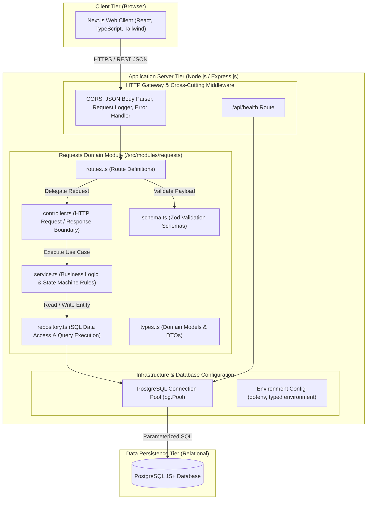
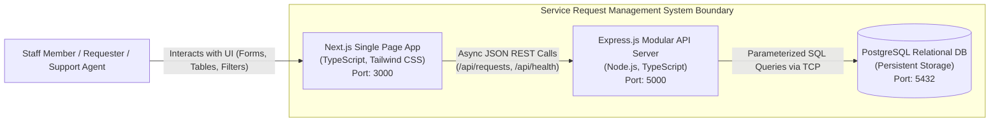
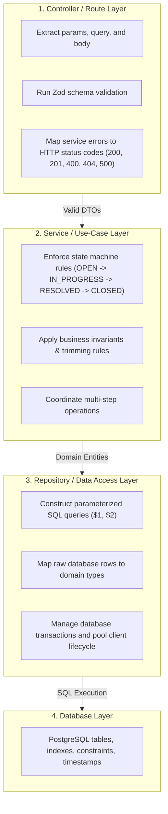
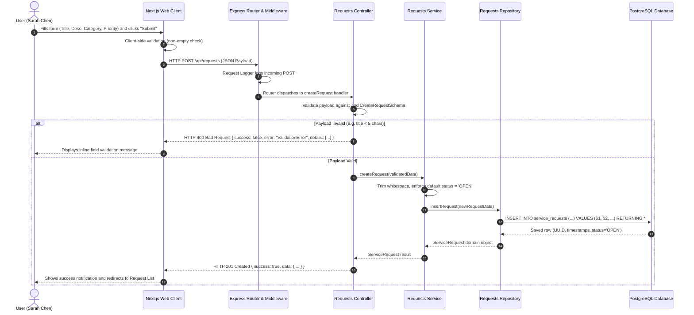

# Service Request Management System — Software Architecture Specification

**Document Version:** 1.0.0  
**Phase:** Day 02 — Architecture & System Design  
**Author:** Trainee Software Engineer, VisionRoot (Pvt) Ltd  
**Project:** Service Request Management System  
**Pattern:** Modular Monolith  

---

## 1. Architecture Overview & Core Principles

The Service Request Management System is architected as a **Modular Monolith**. It unites the frontend web interface and backend API into a cohesive, structured system where domain responsibilities are strictly separated into isolated logical modules and clean functional layers.



### Core Architecture Principles:
1. **Unidirectional Dependency Flow:** Dependencies only point inward: Controller $\rightarrow$ Service $\rightarrow$ Repository $\rightarrow$ Database. Higher layers depend on abstractions of lower layers; lower layers never import or invoke higher layers.
2. **Separation of Concerns:** Each layer has exactly one reason to change. HTTP parsing logic does not know about SQL; SQL repositories do not know about HTTP status codes; business workflows do not depend on Express `req`/`res` objects.
3. **Single Responsibility per Module:** Domain concerns are organized into cohesive vertical slices (e.g. `requests/`).
4. **Authoritative Server Validation:** While client-side validation provides immediate user feedback, the backend service layer is the sole authority for business invariants and security boundaries.

---

## 2. Container & Context Architecture (C4 Level 1 & 2)



| Container | Technology Stack | Responsibilities | Avoids |
| :--- | :--- | :--- | :--- |
| **Frontend Web Client** | Next.js 14+ (React), TypeScript, Tailwind CSS | Render interactive UI, manage local form state, display loading/empty/error states, format dates/labels. | Direct database access, authoritative business rules, credential storage. |
| **Backend API Server** | Node.js, Express.js, TypeScript, Zod | Expose REST endpoints, validate input schemas, enforce status transition workflow, handle errors gracefully. | Tight coupling between routes and SQL, scattered business logic, leaking stack traces. |
| **Database** | PostgreSQL 15+ | Enforce relational integrity, manage primary keys, store immutable timestamps, enforce enum and length constraints. | Storing unvalidated raw payloads, direct public internet exposure. |

---

## 3. Layered Responsibilities & Module Boundaries

The backend application structure enforces strict boundaries as mandated by the VisionRoot engineering standard:



### Layer Responsibility Matrix:

| Layer / Component | Owns | Must Avoid |
| :--- | :--- | :--- |
| **Frontend / UI** | Screens, form inputs, local state, responsive styling, API client methods, user-friendly error banners. | Database connection credentials, bypass validation, holding business rules authoritative over server. |
| **Controller / Route** | Route mapping, HTTP verb handling, extracting path/query params, schema validation invocation, returning HTTP status codes. | Business decision trees, status transition state machines, raw SQL statements, database pool calls. |
| **Service / Use Case** | Business rules, state transition invariants, workflow orchestration, domain validations, entity transformation. | Express `req` and `res` objects, SQL statements, rendering HTML, UI concerns. |
| **Domain / Model** | TypeScript domain types, status enums, category enums, priority enums, data contracts. | Framework-specific logic, HTTP dependencies, external database driver references. |
| **Repository / Data Access** | SQL queries, parameterized queries (`$1, $2`), mapping database records to Domain DTOs, connection execution. | Deciding HTTP status codes, validating user interface behaviors, UI formatting. |
| **Database** | Persistent data tables, primary keys (UUID), foreign keys, check constraints, default timestamps, B-tree indexes. | Direct public-internet or browser access, storing unvalidated payloads. |
| **Cross-Cutting Concerns** | Centralized error handler, request logger, environment variable loader, CORS policy, database connection pool. | Duplicated ad-hoc error formatting or scattered environment reads. |

---

## 4. End-to-End Request Flow: Creating a Service Request

Below is the complete step-by-step trace of how a request travels from the user's browser click to the database and back:



### Detailed Trace Steps:
1. **User Interaction:** The user enters request details into the Next.js form and clicks "Submit".
2. **HTTP Transmission:** The frontend API client issues an asynchronous `POST /api/requests` with `Content-Type: application/json`.
3. **Cross-Cutting Pipeline:** The Express server passes the request through CORS, body parsing, and logging middleware.
4. **Schema Validation:** The controller runs the input payload against the Zod schema (`CreateRequestSchema`). If invalid, execution stops immediately, returning an HTTP 400 response with descriptive field errors.
5. **Business Service Layer:** The controller passes clean DTOs to `requestService.createRequest()`. The service enforces domain rules (e.g., initial status must be `OPEN`, whitespace trimmed).
6. **Data Access Layer:** The service invokes `requestRepository.create()`, which builds a parameterized query:
   ```sql
   INSERT INTO service_requests (id, title, description, category, priority, status, created_at, updated_at)
   VALUES (gen_random_uuid(), $1, $2, $3, $4, 'OPEN', NOW(), NOW())
   RETURNING *;
   ```
7. **Database Persistence:** PostgreSQL executes the query, assigns a primary key UUID and timestamp, and writes the row to persistent storage.
8. **Response Mapping:** The repository transforms the SQL row into a typed domain object, the service returns it to the controller, and the controller sends an `HTTP 201 Created` JSON response.
9. **UI Render:** The Next.js frontend updates its local state, presents a success message to the user, and inserts the new ticket into the active list.

---

## 5. Architectural Backend Folder Structure

Following VisionRoot specifications (Page 6 of the training guide), the backend code is structured into modular feature slices:

```text
backend/
├── src/
│   ├── modules/
│   │   └── requests/
│   │       ├── routes.ts          # Express route definitions
│   │       ├── controller.ts      # HTTP boundary & status code mapping
│   │       ├── service.ts         # Business logic & state machine rules
│   │       ├── repository.ts      # SQL queries & database operations
│   │       ├── schema.ts          # Zod validation schemas
│   │       └── types.ts           # TypeScript interfaces & domain types
│   ├── middleware/
│   │   ├── error-handler.ts       # Centralized error handler
│   │   ├── request-logger.ts      # HTTP request logging middleware
│   │   └── not-found.ts           # 404 handler for unmatched routes
│   ├── config/
│   │   └── environment.ts         # Validated environment configuration
│   ├── database/
│   │   ├── connection.ts          # PostgreSQL connection pool (pg.Pool)
│   │   └── migrations/            # SQL migration scripts (001_create_requests.sql)
│   ├── app.ts                     # Express application setup & middleware assembly
│   └── server.ts                  # Server entry point & graceful shutdown listener
├── tests/
│   ├── unit/                      # Unit tests (service business rules, state transitions)
│   └── integration/               # Integration tests (Supertest API endpoints)
├── .env.example                   # Sanitized environment template
├── .gitignore                     # Git exclusions
├── package.json                   # Dependencies & build scripts
├── tsconfig.json                  # TypeScript compiler options
└── README.md                      # Backend run instructions
```

---

## 6. Where Validation, Business Rules, and Persistence Belong

| Responsibility | Target Layer | Justification |
| :--- | :--- | :--- |
| **Syntactic & Payload Validation** | **Controller / Schema Layer** | Rejects malformed JSON, missing required fields, or invalid types at the entry boundary before executing expensive business logic or opening database transactions. |
| **Business Rules & State Transitions** | **Service Layer** | Business logic (e.g., verifying that a ticket in `OPEN` status cannot jump directly to `RESOLVED`, or that a `CLOSED` ticket cannot be edited) must reside strictly in the service layer, isolated from HTTP controllers and database queries. This ensures rules can be tested in pure unit tests without mocks of Express or PostgreSQL. |
| **Data Persistence & Queries** | **Repository Layer** | All SQL queries, column mappings, and transaction operations reside in repositories. If the database engine or ORM changes in the future, only the repository layer requires changes, leaving business logic completely untouched. |

---

## 7. Trade-offs and Known Risks

### 7.1 Architecture Trade-off: Modular Monolith vs. Microservices
- **Trade-off Selected:** We chose a **Modular Monolith** over a distributed Microservices architecture.
- **Why it is beneficial for this project:**
  - Zero network latency between modules; direct in-process function calls.
  - ACID transactions are guaranteed by PostgreSQL without distributed saga patterns or dual-write failure modes.
  - Single deployment pipeline, straightforward local debugging, and simplified automated testing suites.
- **Consequence / Trade-off:** The frontend and backend run as unified units. If one module experiences a severe CPU spike, it shares memory with the rest of the application. However, for an internal service request management application serving internal staff, this trade-off is overwhelmingly advantageous.

### 7.2 Known Architectural Risk and Mitigation
- **Known Risk:** **Discipline Erosion (Boundary Leakage)**  
  In a monolithic codebase, developers can easily bypass architectural layers (e.g. importing the database pool directly into a controller or embedding business rules inside a repository). Over time, this transforms the modular monolith into an unmaintainable "Big Ball of Mud".
- **Mitigation Strategy:**
  1. Strict TypeScript interface boundaries (`types.ts`).
  2. Automated ESLint import restrictions disallowing direct database imports outside `repository.ts`.
  3. Continuous pull request reviews using the VisionRoot PR checklist requiring reviewers to verify layer isolation before approving code changes.
