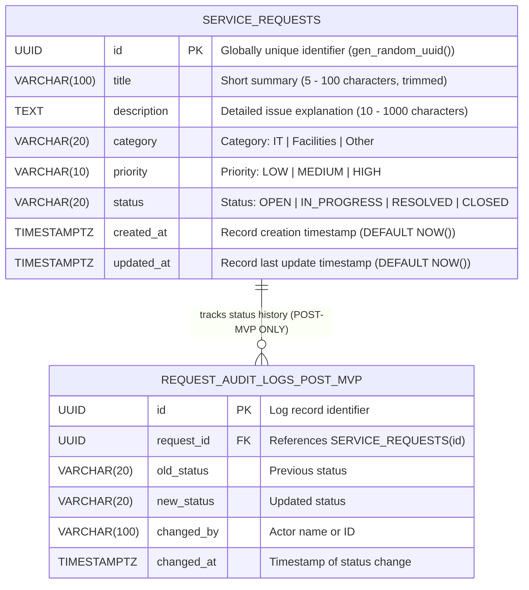

# Service Request Management System — Data Model & Persistence Specification

**Document Version:** 1.0.0  
**Phase:** Day 02 — Architecture & System Design  
**Author:** Trainee Software Engineer, VisionRoot (Pvt) Ltd  
**Target RDBMS:** PostgreSQL 15+  

---

## 1. Entity-Relationship Overview

The database design adheres to 3rd Normal Form (3NF). It provides immediate, robust support for the MVP's **Service Request Management** capabilities while maintaining clear extension points for post-MVP requirements (such as audit logging, internal comments, and user management).



> [!IMPORTANT]
> **Strict MVP Scope Boundary Notice:**
> - **MVP Entity (Must Have for Days 01–10):** `service_requests` is the **only** entity implemented and populated in the MVP.
> - **Post-MVP Entity (Future Enhancement):** `request_audit_logs` is explicitly marked as **Post-MVP only** (aligning with backlog user story `US-07`). It is documented here strictly as an architectural extension point to prove relational schema viability without requiring a breaking database overhaul in future releases. No audit log tables or code will be provisioned in the MVP.

---

## 2. Table Specifications: `service_requests`

### 2.1 Column Definitions

| Column Name | Data Type | Nullable | Default Value | Constraints & Validation Invariants |
| :--- | :--- | :---: | :---: | :--- |
| `id` | `UUID` | **NO** | `gen_random_uuid()` | **PRIMARY KEY**. Immutable unique identifier generated at database level. |
| `title` | `VARCHAR(100)` | **NO** | *None* | `CHECK (char_length(trim(title)) >= 5 AND char_length(trim(title)) <= 100)` |
| `description` | `TEXT` | **NO** | *None* | `CHECK (char_length(trim(description)) >= 10 AND char_length(trim(description)) <= 1000)` |
| `category` | `VARCHAR(20)` | **NO** | *None* | `CHECK (category IN ('IT', 'Facilities', 'Other'))` |
| `priority` | `VARCHAR(10)` | **NO** | `'MEDIUM'` | `CHECK (priority IN ('LOW', 'MEDIUM', 'HIGH'))` |
| `status` | `VARCHAR(20)` | **NO** | `'OPEN'` | `CHECK (status IN ('OPEN', 'IN_PROGRESS', 'RESOLVED', 'CLOSED'))` |
| `created_at` | `TIMESTAMPTZ` | **NO** | `CURRENT_TIMESTAMP` | Server/DB managed. Never updated after row insertion. |
| `updated_at` | `TIMESTAMPTZ` | **NO** | `CURRENT_TIMESTAMP` | Server/DB managed. Automatically updated on any record modification. |

---

## 3. Custom Types & Enumerated Values

To enforce data integrity at the database layer while maintaining compatibility with standard TypeScript string literals, enumerated domains are enforced via PostgreSQL `CHECK` constraints:

```sql
-- Category Domain
CHECK (category IN ('IT', 'Facilities', 'Other'))

-- Priority Domain
CHECK (priority IN ('LOW', 'MEDIUM', 'HIGH'))

-- Status Domain
CHECK (status IN ('OPEN', 'IN_PROGRESS', 'RESOLVED', 'CLOSED'))
```

---

## 4. Indexing & Query Optimization Strategy

The system is anticipated to support frequent read-heavy dashboard operations where users filter by ticket status and sort by creation timestamp descending. The following indexes are established:

| Index Name | Target Table | Indexed Columns | Index Type | Purpose / Query Pattern |
| :--- | :--- | :--- | :---: | :--- |
| `pk_service_requests` | `service_requests` | `id` | B-tree | Primary key lookups: `GET /api/requests/:id` ($O(1)$) |
| `idx_service_requests_status` | `service_requests` | `status` | B-tree | Filtering by status: `SELECT * FROM service_requests WHERE status = $1` |
| `idx_service_requests_created_at` | `service_requests` | `created_at DESC` | B-tree | Ordering queue: `SELECT * FROM service_requests ORDER BY created_at DESC` |
| `idx_service_requests_status_created` | `service_requests` | `status, created_at DESC` | Composite B-tree | Filtered queue queries: `SELECT * FROM service_requests WHERE status = $1 ORDER BY created_at DESC` |

---

## 5. Automated Timestamp Management (Trigger Function)

To guarantee that `updated_at` is always accurate regardless of whether an update is initiated from the Express backend, a database GUI, or an administrative script, a PostgreSQL trigger function updates `updated_at` automatically prior to any `UPDATE` statement:

```sql
CREATE OR REPLACE FUNCTION update_timestamp_column()
RETURNS TRIGGER AS $$
BEGIN
    NEW.updated_at = CURRENT_TIMESTAMP;
    RETURN NEW;
END;
$$ LANGUAGE plpgsql;

CREATE TRIGGER set_timestamp_service_requests
BEFORE UPDATE ON service_requests
FOR EACH ROW
EXECUTE FUNCTION update_timestamp_column();
```

---

## 6. PostgreSQL DDL Design Reference (Implementation Reserved for Day 06)

> [!NOTE]
> **Implementation Phase Notice:**
> The following DDL script serves strictly as an **architectural design reference** for Day 02. Per the VisionRoot 10-day roadmap, database provisioning, connection setup, and actual executable migration files (`database/migrations/001_create_service_requests.sql`) will be implemented on **Day 06 — Database and Persistence**. No executable database files or migration scripts are committed during Day 02.

```sql
-- Architectural Reference DDL: service_requests schema
-- (To be applied in database/migrations/ on Day 06)

-- 1. Ensure UUID generation extension is available
CREATE EXTENSION IF NOT EXISTS "pgcrypto";

-- 2. Create service_requests table
CREATE TABLE IF NOT EXISTS service_requests (
    id UUID PRIMARY KEY DEFAULT gen_random_uuid(),
    title VARCHAR(100) NOT NULL,
    description TEXT NOT NULL,
    category VARCHAR(20) NOT NULL,
    priority VARCHAR(10) NOT NULL DEFAULT 'MEDIUM',
    status VARCHAR(20) NOT NULL DEFAULT 'OPEN',
    created_at TIMESTAMPTZ NOT NULL DEFAULT CURRENT_TIMESTAMP,
    updated_at TIMESTAMPTZ NOT NULL DEFAULT CURRENT_TIMESTAMP,

    -- Data integrity constraints
    CONSTRAINT check_title_length CHECK (char_length(trim(title)) >= 5 AND char_length(trim(title)) <= 100),
    CONSTRAINT check_description_length CHECK (char_length(trim(description)) >= 10 AND char_length(trim(description)) <= 1000),
    CONSTRAINT check_category_enum CHECK (category IN ('IT', 'Facilities', 'Other')),
    CONSTRAINT check_priority_enum CHECK (priority IN ('LOW', 'MEDIUM', 'HIGH')),
    CONSTRAINT check_status_enum CHECK (status IN ('OPEN', 'IN_PROGRESS', 'RESOLVED', 'CLOSED'))
);

-- 3. Create indexes for high-frequency queries
CREATE INDEX IF NOT EXISTS idx_service_requests_status 
    ON service_requests(status);

CREATE INDEX IF NOT EXISTS idx_service_requests_created_at 
    ON service_requests(created_at DESC);

CREATE INDEX IF NOT EXISTS idx_service_requests_status_created 
    ON service_requests(status, created_at DESC);

-- 4. Create trigger function to manage updated_at
CREATE OR REPLACE FUNCTION update_service_requests_updated_at()
RETURNS TRIGGER AS $$
BEGIN
    NEW.updated_at = CURRENT_TIMESTAMP;
    RETURN NEW;
END;
$$ LANGUAGE plpgsql;

-- 5. Attach trigger to service_requests table
DROP TRIGGER IF EXISTS trigger_service_requests_updated_at ON service_requests;
CREATE TRIGGER trigger_service_requests_updated_at
    BEFORE UPDATE ON service_requests
    FOR EACH ROW
    EXECUTE FUNCTION update_service_requests_updated_at();

-- Comments for documentation
COMMENT ON TABLE service_requests IS 'Core entity storing employee IT and Facilities service requests';
COMMENT ON COLUMN service_requests.id IS 'Immutable UUID v4 primary key';
COMMENT ON COLUMN service_requests.status IS 'Current lifecycle state (OPEN, IN_PROGRESS, RESOLVED, CLOSED)';
```

---

## 7. Data Lifecycle & Mutation Invariants

1. **Creation Invariant:**
   - On `INSERT`, `status` must initialize to `'OPEN'`.
   - `created_at` and `updated_at` are initialized to identical server timestamps.
2. **Update Invariant:**
   - `id` and `created_at` are strictly immutable; attempts to modify them are rejected by the repository layer.
   - `updated_at` must always be strictly greater than or equal to `created_at`.
3. **Deletion Policy:**
   - In accordance with enterprise audit standards, service requests are not hard-deleted in normal operation. Cancelled or discarded requests are moved to the `'CLOSED'` terminal state.

