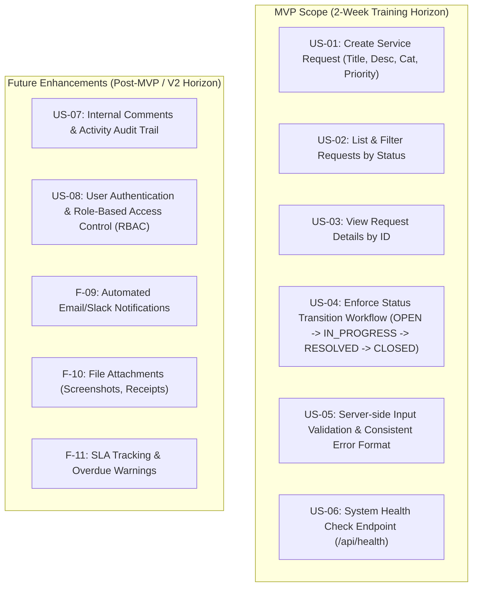
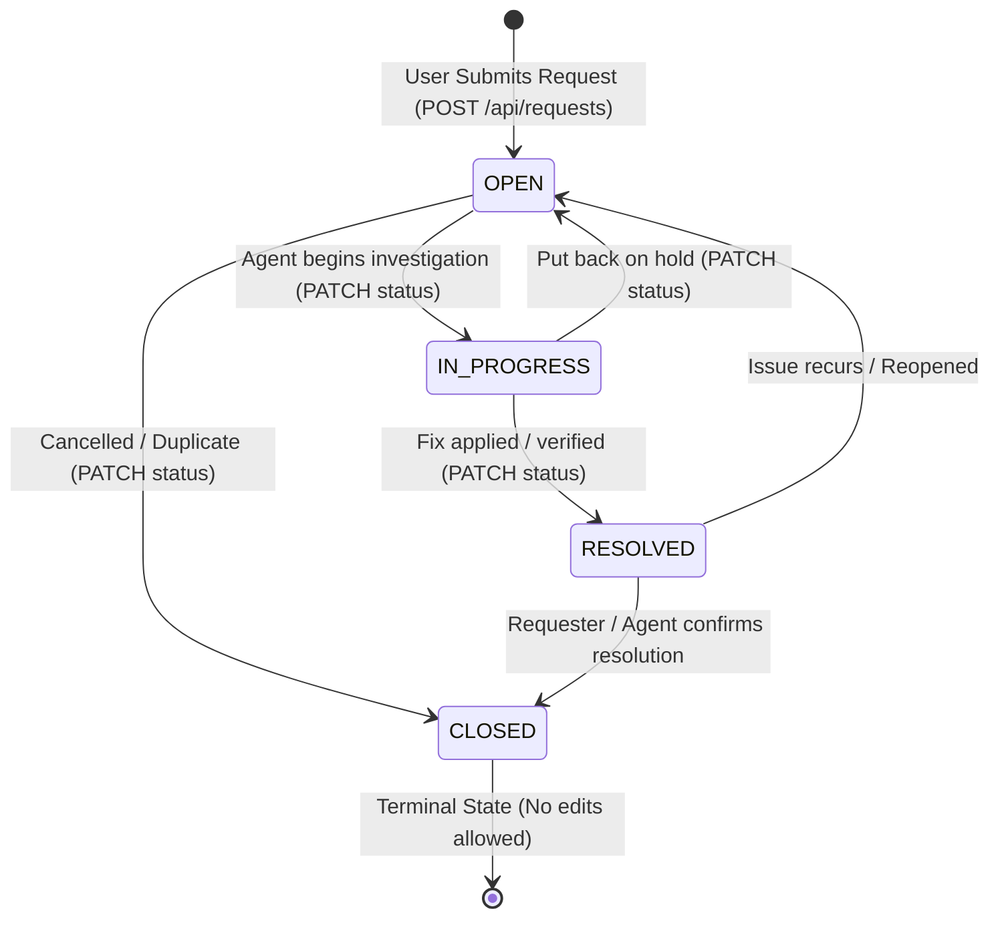

# Service Request Management System — Requirements & SDLC Specification

**Document Version:** 1.0.0  
**Phase:** Day 01 — Requirements & SDLC  
**Author:** Trainee Software Engineer, VisionRoot (Pvt) Ltd  
**Project:** Service Request Management System (Internal Monolith MVP)  

---

## 1. Executive Summary & Problem Statement

### 1.1 Problem Statement
In fast-growing organizations, internal service requests (such as IT hardware repairs, software access provisioning, network configuration, and office facilities maintenance) are frequently handled via ad-hoc channels: direct messaging, unstructured emails, or verbal requests. 

This informal communication creates severe operational challenges:
- **Zero Visibility:** Requesters lack visibility into the status of their requests and have no way of knowing whether a request is being actively investigated or forgotten.
- **Untracked Service Work:** Support teams cannot prioritize urgent blockers over low-priority routine requests, leading to SLA breaches.
- **Lost Context & Information:** Requests lack mandatory metadata (clear title, description, category, priority), forcing support teams to engage in repeated back-and-forth clarification.
- **Absence of Governance & Auditability:** Status transitions happen arbitrarily without validated workflows, preventing management from tracking turnaround times, team velocity, or unresolved issues.

### 1.2 Proposed Solution
The **Service Request Management System** is a lightweight, reliable, full-stack internal web application. It allows employees to submit structured service requests with standardized metadata, enables support teams to manage and filter requests through a governed status workflow, guarantees data persistence in a relational database, and exposes standardized REST API endpoints for seamless frontend-backend communication.

---

## 2. Stakeholders & User Personas

| Persona | Role | Primary Goals | Key Pain Points |
| :--- | :--- | :--- | :--- |
| **Sarah Chen**<br>*(Employee / Requester)* | Business Operations Associate | Quickly submit service requests with clear priority and check their progress without interrupting support staff. | Frustrated by unread Slack messages, forgotten requests, and lack of status updates. |
| **Alex Rivera**<br>*(Support Agent / IT Specialist)* | IT & Facilities Support Specialist | View all active requests in a single queue, filter by status, inspect full request details, and advance requests through validated state transitions. | Overwhelmed by duplicate requests, ambiguous descriptions, and unstructured workflows. |
| **Priya Patel**<br>*(Manager / System Auditor)* | IT Operations Manager | Ensure operational integrity, verify system uptime via automated health checks, and inspect request resolution metrics. | Lacks clear traceability of service history and system health metrics. |

---

## 3. Scope & MoSCoW Prioritization

To ensure predictable delivery within the 2-week training timeline while adhering to professional engineering standards, features are partitioned strictly into **MVP (Must Have)** and **Post-MVP / Future Improvements (Could Have / Won't Have)**.



### 3.1 MoSCoW Prioritization Table

| Requirement ID | Feature Description | MoSCoW Status | Justification |
| :--- | :--- | :---: | :--- |
| **FR-01** | Create service request with title, description, category, priority | **Must Have (MVP)** | Core entry point for all service requests. |
| **FR-02** | List requests with pagination and status filter | **Must Have (MVP)** | Essential for support engineers to manage queue. |
| **FR-03** | View single request details by ID | **Must Have (MVP)** | Required to read complete descriptions and metadata. |
| **FR-04** | Update request status according to state machine rules | **Must Have (MVP)** | Core business workflow invariant. |
| **FR-05** | Server-side validation and structured error response | **Must Have (MVP)** | Prevents corrupt or malformed data entering database. |
| **FR-06** | Health check endpoint (`GET /api/health`) | **Must Have (MVP)** | Operational requirement for monitoring uptime. |
| **FR-07** | Activity log / Status transition audit trail | **Could Have (V2)** | Valuable for auditing, deferred to ensure core delivery. |
| **FR-08** | Authentication & Role-Based Access Control (RBAC) | **Could Have (V2)** | Internal prototype runs in trusted VPC; mock roles in MVP. |
| **FR-09** | Email / Webhook notification on status change | **Won't Have (V2)** | Requires 3rd-party SMTP/SendGrid setup. |
| **FR-10** | Attachment uploads (PDF, images) | **Won't Have (V2)** | Requires S3 / object storage integration. |

---

## 4. Functional Requirements (FR)

- **FR-01: Request Submission**:
  - The system shall allow users to submit requests specifying: `title`, `description`, `category` (`IT`, `Facilities`, `Other`), and `priority` (`LOW`, `MEDIUM`, `HIGH`).
  - Upon submission, the request must be assigned a unique identifier (UUID v4), the initial status of `OPEN`, and automatic server timestamps (`created_at`, `updated_at`).

- **FR-02: Request Listing and Filtering**:
  - The system shall display a list of requests ordered by `created_at` descending.
  - The user can filter requests by status (`OPEN`, `IN_PROGRESS`, `RESOLVED`, `CLOSED`, or all).

- **FR-03: Request Details**:
  - The system shall fetch complete details of a request by its unique `id`.
  - If the ID does not exist, the system must return a standard HTTP 404 response.

- **FR-04: Workflow Status Transition**:
  - The system shall allow updating a request's status only along permitted transitions:
    - `OPEN` $\rightarrow$ `IN_PROGRESS` or `CLOSED`
    - `IN_PROGRESS` $\rightarrow$ `RESOLVED` or `OPEN`
    - `RESOLVED` $\rightarrow$ `CLOSED` or `OPEN` (reopened)
    - `CLOSED` $\rightarrow$ Terminal state (no further transitions permitted)
  - Any illegal transition (e.g. `OPEN` $\rightarrow$ `RESOLVED`, or updating a `CLOSED` ticket) must be rejected with HTTP 400 Bad Request.

- **FR-05: Input Validation & Sanitization**:
  - Field constraints:
    - `title`: String, trimmed of leading/trailing spaces, minimum 5 characters, maximum 100 characters.
    - `description`: String, trimmed, minimum 10 characters, maximum 1000 characters.
    - `category`: Must be one of `['IT', 'Facilities', 'Other']`.
    - `priority`: Must be one of `['LOW', 'MEDIUM', 'HIGH']`.
  - Malformed payloads must return HTTP 400 with a structured field-level error breakdown.

- **FR-06: Health Check Endpoint**:
  - The system shall expose `GET /api/health` returning HTTP 200, system uptime, timestamp, and database connectivity status.

---

## 5. Non-Functional Requirements (NFR)

- **NFR-01: Performance & Latency**:
  - 95% of API requests (`GET`, `POST`, `PATCH`) must complete within 200ms under standard local/intranet loads.
  - Database queries must leverage indexes on `status` and `created_at`.

- **NFR-02: Reliability & Data Integrity**:
  - All state updates must be transactional and committed to PostgreSQL.
  - Application restarts must preserve all stored requests without state loss or data corruption.

- **NFR-03: Security & Safe Error Handling**:
  - Never expose database stack traces, SQL error strings, or environment secrets in client API responses.
  - Implement centralized error handling middleware producing standardized error JSON schemas.
  - Sanitize all incoming user inputs to mitigate injection risks.

- **NFR-04: Usability & Accessibility**:
  - Responsive web design supporting standard desktop screens (1024px+) down to mobile viewports (375px+).
  - Clear visual affordances for loading states, empty states, and error alerts.

- **NFR-05: Maintainability & Architectural Cleanliness**:
  - Strict separation of concerns adhering to the modular monolith pattern: Controller $\rightarrow$ Service $\rightarrow$ Repository.
  - Zero SQL queries or database client calls inside HTTP controllers.

---

## 6. Detailed User Stories & Acceptance Criteria

### US-01: Submit a New Service Request
- **As an** Employee (Requester),  
- **I want to** submit a new service request with a title, description, category, and priority,  
- **So that** the relevant internal support team is notified and can resolve my issue.

#### Acceptance Criteria
```gherkin
Scenario: Successful request submission
  Given I am on the service request submission form
  When I enter a valid title "Flickering monitor on Desk 12"
  And I enter a description "The external monitor turns black intermittently when connected via HDMI."
  And I select category "IT"
  And I select priority "MEDIUM"
  And I submit the form
  Then the system saves the request with status "OPEN"
  And returns HTTP 201 Created with the saved record including a generated UUID and timestamps
  And the UI displays a confirmation message with the new Request ID.

Scenario: Submission fails with missing or invalid fields
  Given I am on the service request submission form
  When I submit the form with an empty title or a title shorter than 5 characters
  Then the system rejects the submission with HTTP 400 Bad Request
  And returns a JSON response specifying "title must be at least 5 characters"
  And no record is created in the database.

Scenario: Whitespace trimming on submission
  Given I provide a title with leading and trailing whitespace "   Broken Chair   "
  When the request is submitted
  Then the system stores the trimmed value "Broken Chair" in the database.
```

---

### US-02: View and Filter Service Requests
- **As a** Support Agent,  
- **I want to** view a list of all submitted requests and filter them by status,  
- **So that** I can prioritize incoming work and identify bottlenecks in the queue.

#### Acceptance Criteria
```gherkin
Scenario: View all service requests
  Given there are existing requests in the system with various statuses
  When I navigate to the request list page
  Then I see a table or list showing request ID, title, category, priority, status, and creation date
  And the requests are sorted with the newest first (created_at DESC).

Scenario: Filter requests by status
  Given there are 3 "OPEN" requests and 2 "RESOLVED" requests
  When I select "OPEN" in the status filter dropdown
  Then only the 3 "OPEN" requests are displayed
  And the system issues a GET request with query parameter "?status=OPEN".

Scenario: Empty state feedback
  Given there are no requests matching status "CLOSED"
  When I filter by "CLOSED"
  Then the UI displays an empty state banner: "No requests found for this status".
```

---

### US-03: View Single Request Details
- **As a** Requester or Support Agent,  
- **I want to** view the complete details of a specific service request,  
- **So that** I can read the full description, understand current status, and review timestamps.

#### Acceptance Criteria
```gherkin
Scenario: Successfully retrieve request details
  Given a service request with ID "550e8400-e29b-41d4-a716-446655440000" exists
  When I navigate to its details page or issue GET /api/requests/550e8400-e29b-41d4-a716-446655440000
  Then the system returns HTTP 200 OK
  And the response contains id, title, full description, category, priority, status, created_at, and updated_at.

Scenario: Request not found
  Given no request exists with ID "99999999-9999-9999-9999-999999999999"
  When I attempt to view this request
  Then the system returns HTTP 404 Not Found
  And returns a structured error body: { "error": "RequestNotFound", "message": "Service request with ID ... was not found" }
  And the UI displays a "Request Not Found" notice with a link back to the list.
```

---

### US-04: Transition Request Status via Governed Workflow
- **As a** Support Agent,  
- **I want to** update the status of a request following agreed business rules,  
- **So that** the lifecycle of a request accurately reflects its real-world resolution progress.

#### Acceptance Criteria
```gherkin
Scenario: Valid transition from OPEN to IN_PROGRESS
  Given a request exists with status "OPEN"
  When I update the status to "IN_PROGRESS" via PATCH /api/requests/:id/status
  Then the system updates the record status to "IN_PROGRESS"
  And updates the "updated_at" timestamp to current server time
  And returns HTTP 200 OK with the updated request payload.

Scenario: Valid transition from IN_PROGRESS to RESOLVED
  Given a request exists with status "IN_PROGRESS"
  When I update the status to "RESOLVED"
  Then the system records status "RESOLVED" and returns HTTP 200 OK.

Scenario: Reject invalid status transition (e.g. OPEN to RESOLVED)
  Given a request exists with status "OPEN"
  When I attempt to update the status directly to "RESOLVED"
  Then the system rejects the transition with HTTP 400 Bad Request
  And returns an error message: "Invalid status transition from OPEN to RESOLVED"
  And the request status remains "OPEN".

Scenario: Reject modifications to a CLOSED request
  Given a request exists with status "CLOSED"
  When I attempt to change its status to "IN_PROGRESS"
  Then the system rejects the request with HTTP 400 Bad Request
  And returns an error message: "Cannot modify a CLOSED service request".
```

---

### US-05: Server-Side Input Validation and Predictable Errors
- **As a** Full-Stack Developer and Reviewer,  
- **I want** all incoming API payloads strictly validated on the server with standardized error schemas,  
- **So that** data corruption is prevented and frontend/client consumers receive clear, actionable feedback.

#### Acceptance Criteria
```gherkin
Scenario: Missing required fields
  Given an API client posts to POST /api/requests with empty payload {}
  When the backend controller and validation schema evaluate the request
  Then the server immediately halts processing before invoking the service or repository
  And returns HTTP 400 Bad Request
  And response body follows standard error schema:
    {
      "success": false,
      "error": "ValidationError",
      "details": [
        { "field": "title", "issue": "Title is required" },
        { "field": "description", "issue": "Description is required" },
        { "field": "category", "issue": "Category must be IT, Facilities, or Other" },
        { "field": "priority", "issue": "Priority must be LOW, MEDIUM, or HIGH" }
      ]
    }

Scenario: Invalid enum value
  Given a request payload with category "Emergency"
  When submitted to POST /api/requests
  Then the server returns HTTP 400 Bad Request specifying that category is invalid.
```

---

### US-06: System Health Check Endpoint
- **As a** DevOps / Support Engineer,  
- **I want** a dedicated health check endpoint at `/api/health`,  
- **So that** automated monitors and load balancers can verify the service and database are operational.

#### Acceptance Criteria
```gherkin
Scenario: Healthy service response
  Given the Express backend is running and connected to PostgreSQL
  When an HTTP GET is performed on /api/health
  Then the server responds with HTTP 200 OK
  And body contains:
    {
      "status": "healthy",
      "uptime": "<number_of_seconds>",
      "timestamp": "<iso_timestamp>",
      "database": "connected"
    }

Scenario: Database connectivity failure
  Given the PostgreSQL database is unreachable or disconnected
  When an HTTP GET is performed on /api/health
  Then the server responds with HTTP 503 Service Unavailable
  And body contains:
    {
      "status": "unhealthy",
      "uptime": "<number_of_seconds>",
      "timestamp": "<iso_timestamp>",
      "database": "disconnected"
    }
```

---

### US-07 (Future Enhancement): Internal Comments and Audit Trail
- **As a** Support Agent,  
- **I want to** add internal notes to a service request and view a historical timeline of state changes,  
- **So that** teammates can collaborate and follow previous troubleshooting actions.

#### Acceptance Criteria (Backlog)
```gherkin
Scenario: Add internal note
  Given an existing request
  When an agent adds a comment "Ordered replacement cable from vendor"
  Then the comment is appended to the request timeline with author name and timestamp.
```

---

## 7. State Machine & Status Workflow Rules



### Transition Validation Matrix

| Current State | Target: OPEN | Target: IN_PROGRESS | Target: RESOLVED | Target: CLOSED |
| :---: | :---: | :---: | :---: | :---: |
| **OPEN** | ❌ (Same) | ✅ Allowed | ❌ Forbidden (400) | ✅ Allowed |
| **IN_PROGRESS** | ✅ Allowed | ❌ (Same) | ✅ Allowed | ❌ Forbidden (400) |
| **RESOLVED** | ✅ Reopen | ❌ Forbidden (400) | ❌ (Same) | ✅ Allowed |
| **CLOSED** | ❌ Forbidden (400) | ❌ Forbidden (400) | ❌ Forbidden (400) | ❌ (Same) |

---

## 8. Data Dictionary & Model Invariants

| Attribute | Data Type | Nullable | Default | Validation & Invariant Rules |
| :--- | :--- | :---: | :---: | :--- |
| `id` | UUID v4 | No | `uuid_generate_v4()` | Primary Key, globally unique, immutable. |
| `title` | VARCHAR(100) | No | None | Trimmed, 5 to 100 characters. Single line string. |
| `description` | TEXT | No | None | Trimmed, 10 to 1000 characters. |
| `category` | VARCHAR(20) | No | None | Enum constraint: `IT`, `Facilities`, `Other`. |
| `priority` | VARCHAR(10) | No | `MEDIUM` | Enum constraint: `LOW`, `MEDIUM`, `HIGH`. |
| `status` | VARCHAR(20) | No | `OPEN` | Enum constraint: `OPEN`, `IN_PROGRESS`, `RESOLVED`, `CLOSED`. Governed by state transition matrix. |
| `created_at` | TIMESTAMPTZ | No | `NOW()` | Managed automatically by database/server. Immutable. |
| `updated_at` | TIMESTAMPTZ | No | `NOW()` | Automatically updated on every update. |

---

## 9. Definition of Done (DoD)

A requirement or user story is considered **Done** only when all of the following criteria are met:
1. **Business Acceptance:** All specified acceptance criteria are fulfilled.
2. **Architecture Compliance:** Code respects layer boundaries (No SQL in controllers, no UI logic in services).
3. **Validation & Security:** All user inputs are validated on the server. Zero leaked stack traces or sensitive credentials.
4. **Testing Evidence:**
   - Critical business logic (e.g. status transition rules, validation) is covered by unit tests.
   - API endpoints have integration tests covering both happy path (200/201) and error cases (400/404).
5. **Linting & Types:** Code passes TypeScript type checks and ESLint without warnings/errors.
6. **Documentation & Traceability:** API contract, README run instructions, and daily evidence log are updated with commit hash.
7. **Peer Review:** Code changes are submitted via a feature branch Pull Request using the standard PR template.

---

## 10. Requirement Verification & Traceability Matrix

| Requirement / Story | Verification Method | Test Case Description | Expected Result |
| :--- | :--- | :--- | :--- |
| **FR-01 / US-01** (Creation) | Automated API Integration Test | Submit valid payload to `POST /api/requests` | Status 201, UUID returned, record stored in DB with status `OPEN`. |
| **FR-01 / US-05** (Validation) | Automated Unit & API Test | Submit payload with title length < 5 characters | Status 400 Bad Request, descriptive error JSON, 0 DB rows added. |
| **FR-02 / US-02** (Listing/Filtering) | Automated API Test & UI verification | Issue `GET /api/requests?status=OPEN` | Status 200 OK, array contains only requests where `status === 'OPEN'`. |
| **FR-03 / US-03** (Details) | Automated API Test | Issue `GET /api/requests/{valid_id}` and `GET /api/requests/{unknown_id}` | 200 OK with full payload for valid; 404 Not Found for unknown. |
| **FR-04 / US-04** (State Transitions) | Unit Test (Service) & API Integration Test | Attempt `OPEN` $\rightarrow$ `IN_PROGRESS` (valid), then `OPEN` $\rightarrow$ `RESOLVED` (invalid) | Valid returns 200; Invalid returns 400 with transition error message. |
| **FR-06 / US-06** (Health Check) | Automated Integration Test | Issue `GET /api/health` with DB up vs DB disconnected | 200 OK healthy; 503 Service Unavailable when DB is down. |
