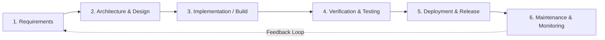

# Day 01 Learning Notes — Software Development Lifecycle (SDLC) & Requirements Engineering

**Date:** 2026-11-11  
**Trainee:** Trainee Software Engineer  
**Program:** VisionRoot 2-Week Engineering Onboarding  
**Topic:** Requirements and SDLC  

---

## 1. The Software Development Lifecycle (SDLC) in Practice

Engineering professional software requires moving systematically through defined phases rather than jumping straight into coding. Writing code without verified requirements leads to rework, missed business expectations, and fragile architecture.

### The 6 Core Phases:
1. **Requirements & Scope Definition:**
   - Understand the real business problem, who the users are, and what business value needs to be unlocked.
   - Define clear boundaries: what is inside the MVP versus what is deferred to future iterations.
2. **Architecture & Design:**
   - Define system boundaries, data contracts, and data models before writing application logic.
   - Select appropriate architectural patterns (e.g. modular monolith vs microservices) based on scale and team structure.
3. **Implementation / Build:**
   - Develop modular, readable, and decoupled code following established patterns (Controller $\rightarrow$ Service $\rightarrow$ Repository).
   - Enforce clean separation of concerns and avoid leaky abstractions.
4. **Verification & Automated Testing:**
   - Write automated unit tests for business logic and integration tests for API endpoints.
   - Validate negative paths, edge cases, and failure modes, not just the happy path.
5. **Deployment & Release:**
   - Automate repeatable builds, containerization, environment configuration, and health checks.
   - Guarantee zero hardcoded secrets or credentials in repositories.
6. **Maintenance & Monitoring:**
   - Track health metrics, error logs, and system performance in runtime environments.
   - Triage bugs systematically with root-cause analysis and regression tests.

---

## 2. User Stories & Acceptance Criteria

### 2.1 Anatomy of a Good User Story
User stories capture business intent from the end-user perspective using the standard template:
> **As a** `<type of user>`,  
> **I want to** `<perform an action>`,  
> **So that** `<achieve a desired business outcome>`.

We evaluate user stories against the **INVEST** quality criteria:
- **I**ndependent: Can be built and released independently of another story where possible.
- **N**egotiable: Open to discussion and refinement between engineers and stakeholders.
- **V**aluable: Delivers clear business or operational value to the user.
- **E**stimable: Sufficiently understood that engineers can estimate complexity.
- **S**mall: Sized appropriately to be delivered within a single sprint.
- **T**estable: Accompanied by verifiable acceptance criteria.

### 2.2 Acceptance Criteria & Gherkin Syntax
Acceptance criteria specify the exact conditions under which a user story is considered complete. We use the **Given-When-Then** format:
- **Given** establishes the initial state or preconditions.
- **When** describes the user's action or event trigger.
- **Then** specifies the expected outcome, side effects, and state assertions.

Writing criteria this way eliminates ambiguity and bridges requirements directly into automated test cases (e.g. Jest / Supertest integration tests).

---

## 3. Functional vs Non-Functional Requirements

- **Functional Requirements (FR):**
  - Define *what* the system does (behavior, features, operations).
  - Example: "The system must reject status transitions from `OPEN` directly to `RESOLVED` with an HTTP 400 response."
- **Non-Functional Requirements (NFR):**
  - Define *how well* the system performs its functions (qualities, constraints, architecture).
  - Categorized under: Performance, Reliability, Security, Maintainability, Usability.
  - Example: "All incoming requests must be processed within 200ms and must never expose internal database exception traces to the user."

---

## 4. Scope Management, Prioritization & Definition of Done

### 4.1 Defending the MVP (Minimum Viable Product)
The goal of an MVP is to deliver the smallest possible increment of working, end-to-end software that solves the core problem and delivers testable evidence. Using **MoSCoW Prioritization**:
- **Must Have (MVP):** Features without which the system does not solve the core service request problem (Create, View, Filter, Workflow State Machine, Database Persistence, Validation).
- **Could Have / Won't Have (Post-MVP):** Complex features that increase scope risk (e.g., RBAC, OAuth2, attachments, email webhooks) are deferred to subsequent sprints.

### 4.2 Definition of Done (DoD)
A feature is **not done** when it merely works on a developer's local machine. It is **done** only when:
- Acceptance criteria pass.
- Server-side validation and security rules are enforced.
- Automated tests pass.
- Architecture layer boundaries are maintained.
- Code review is completed with documented evidence and clean commit history.
